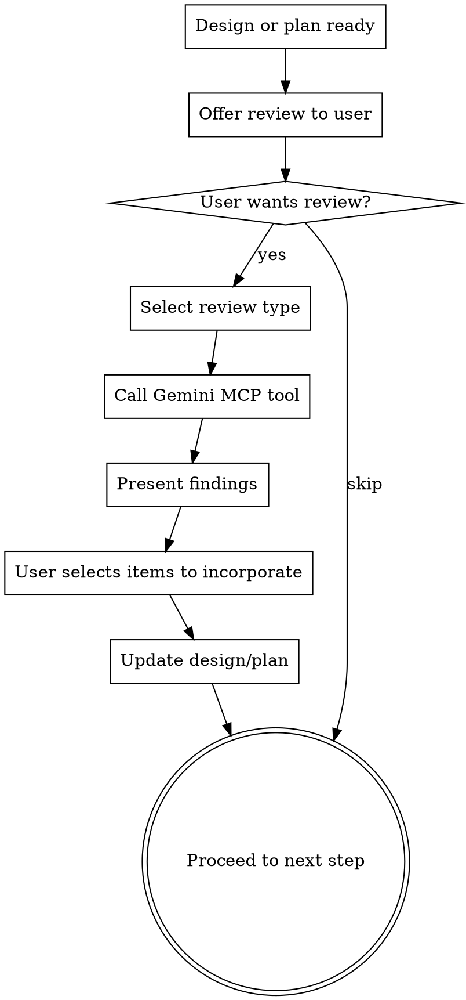

# Adversarial Review via Gemini

## Overview

Send designs and plans to Gemini 3.1 Pro for comprehensive adversarial review. Gemini acts as an experienced technology leader stress-testing every aspect: architecture, product thinking, definition quality, risks, missed opportunities, and where the work could shine more.

This is a second opinion on everything, not just code review. It covers the "what" and "why" as much as the "how."

## When to Use

- After a design document is approved (brainstorming skill output)
- After an implementation plan is written (writing-plans skill output)
- When the user asks for a second opinion or adversarial review
- Before major implementation work begins

## Process

## Step 1: Offer the Review

Present the user with a choice using AskUserQuestion:

**Question:** "Would you like Gemini 3.1 Pro to adversarially review this [design/plan] before we proceed?"

**Options:**
1. **Full review** - Architecture, product thinking, definition quality, risks, missed opportunities, areas for improvement
2. **Skip** - Proceed directly to [next workflow step]

## Step 2: Call the Gemini MCP Tool

For design documents, use `review_design`:
- `content`: The full design document text
- `projectContext`: Brief project background if available from PROJECT.md

For implementation plans, use `review_plan`:
- `content`: The full implementation plan text
- `designContext`: The design document the plan implements (if available)
- `projectContext`: Brief project background if available from PROJECT.md

## Step 3: Present Findings

Format Gemini's response for the user. Group findings by severity:

**CRITICAL findings first** - These need to be addressed before proceeding. Present each one clearly with Gemini's suggested fix.

**IMPORTANT findings next** - Significant gaps worth discussing. The user decides which to address.

**CONSIDER items last** - Nice-to-haves and stretch ideas. Quick scan, pick any that resonate.

**Missed Opportunities section** - Always highlight this separately. These are features and capabilities Gemini suggested that weren't in the original. Present as a numbered list so the user can pick.

## Step 4: Incorporate Feedback

Ask the user which findings to incorporate:

**Question:** "Which items do you want to incorporate?"

Let the user select specific items. Then update the design document or plan accordingly before proceeding to the next workflow step.

## Key Principles

- **Always present as optional.** The user can skip the review at any time.
- **Don't editorialize on Gemini's feedback.** Present it faithfully and let the user decide what's valuable.
- **Missed opportunities are the high-value output.** Features and ideas the team hadn't considered are often the most valuable part of the review.
- **One review per checkpoint.** Don't loop through multiple Gemini reviews. One pass, user decides, move on.
