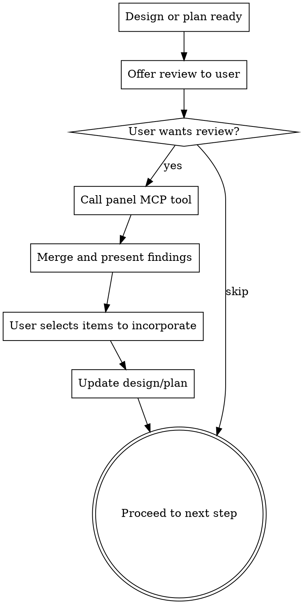

# Adversarial Review via a Multi-Vendor Panel

## Overview

Send designs and plans to a panel of three non-Anthropic models on OpenRouter for comprehensive adversarial review: **GPT-6.1 Sol** (OpenAI), **Grok 4.7** (xAI), and **GLM 5.3 Flash X** (Z.ai). Each acts as an experienced technology leader stress-testing every aspect: architecture, product thinking, definition quality, risks, missed opportunities, and where the work could shine more.

The panel is deliberately non-Anthropic and multi-vendor. The author of the design is usually Claude, and a Claude reviewer shares its blind spots. Different vendors miss different things; findings raised by more than one reviewer are the strongest signal. The panel was chosen from a nine-model bake-off on 2026-10-24 (`~/Development/gemini-reviewer/bakeoff/2026-10-24/RESULTS.md`).

This is a second opinion on everything, not just code review. It covers the "what" and "why" as much as the "how."

## When to Use

- After a design document is approved (brainstorming skill output)
- After an implementation plan is written (writing-plans skill output)
- When the user asks for a second opinion or adversarial review
- Before major implementation work begins

## Process

## Step 1: Offer the Review

Present the user with a choice using AskUserQuestion:

**Question:** "Would you like the review panel (GPT-6.1 Sol, Grok 4.7, GLM 5.3 Flash X) to adversarially review this [design/plan] before we proceed?"

**Options:**
1. **Full review** - Three reviewers in parallel: architecture, product thinking, definition quality, risks, missed opportunities. About $0.25, up to ~6 minutes.
2. **Skip** - Proceed directly to [next workflow step]

## Step 2: Call the Panel MCP Tool

For design documents, use `mcp__adversarial-reviewer__review_design`:
- `content`: The full design document text
- `projectContext`: Brief project background if available from PROJECT.md

For implementation plans, use `mcp__adversarial-reviewer__review_plan`:
- `content`: The full implementation plan text
- `designContext`: The design document the plan implements (if available)
- `projectContext`: Brief project background if available from PROJECT.md

The tool returns a status header (which reviewers responded, time, cost) followed by each reviewer's full review under `# Review by <model>`. If a reviewer failed, say so and proceed with the ones that responded. If all failed, report the error text and offer to retry or skip.

## Step 3: Merge and Present Findings

Merge the reviews into one list. Do not present three separate reviews.

- **Deduplicate.** When reviewers raise the same issue, present it once and list who raised it, e.g. *(Sol, Grok)*.
- **Consensus first within each severity.** Findings raised by two or three reviewers come before single-reviewer findings.
- **Use the highest severity any reviewer assigned**, and note disagreement if one reviewer called it CRITICAL and another CONSIDER.
- **Check claims against the document.** If a reviewer asserts the document lacks something it actually covers, drop the finding and say so in one line at the end ("Dropped: Grok's point on X, already covered in section Y"). Do not otherwise editorialize.

Then group by severity:

**CRITICAL findings first** - These need to be addressed before proceeding. Present each one clearly with the suggested fix.

**IMPORTANT findings next** - Significant gaps worth discussing. The user decides which to address.

**CONSIDER items last** - Nice-to-haves and stretch ideas. Quick scan, pick any that resonate.

**Missed Opportunities section** - Always highlight this separately. These are features and capabilities the reviewers suggested that weren't in the original. Present as a numbered list so the user can pick.

## Step 4: Incorporate Feedback

Ask the user which findings to incorporate:

**Question:** "Which items do you want to incorporate?"

Let the user select specific items. Then update the design document or plan accordingly before proceeding to the next workflow step.

## Key Principles

- **Always present as optional.** The user can skip the review at any time.
- **Present findings faithfully.** Merging and deduplicating is required; rewriting a reviewer's point into something it didn't say is not. Only drop a finding when the document demonstrably already covers it.
- **Missed opportunities are the high-value output.** Features and ideas the team hadn't considered are often the most valuable part of the review.
- **One review per checkpoint.** Don't loop through multiple panel reviews. One pass, user decides, move on.
